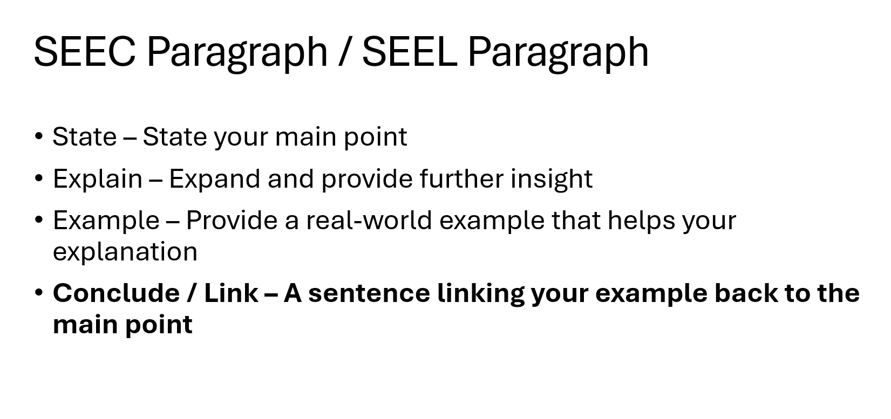

# Phase 2: Researching and Planning

!!! warning "Headings"

    Remember to add headings as needed for each of the following.

As with before, we'll look at what it specifically in the task, then visit certain areas on a separate page which need further explanation.

??? note "Research your Chosen Issue"

    What’s already available on the topic? Find news articles, journal articles, or interview students / teachers (if local issue) to get a sense of what people think of the topic.

    Make sure to include any links / interviews / surveys **in your Markdown / Jupyter documentation.**

??? note "Discuss the Findings"

    **Discuss** the above information in at least one SEEL / SEEC Paragraph.

    **One to two paragraphs is fine.**&#x20;

    Include this in your Markdown / Jupyter documentation.

    !!! warning "Discuss"

        Identify issues and provide points for and/or against.

    <figure><figcaption>
SEEC / SEEL Paragraph
</figcaption></figure>

??? note "Acquire your Data"

    Acquire any data you need, whether it be through <https://www.kaggle.com/> (Secondary Research), Google Forms (Primary Research) or another source.

??? note "Planning"

    Create a **data dictionary** to show the type of data and parameters required for your dataset. [The next page shows much more information about how to do this.](phase-2-researching-and-planning/data-dictionary.md)
