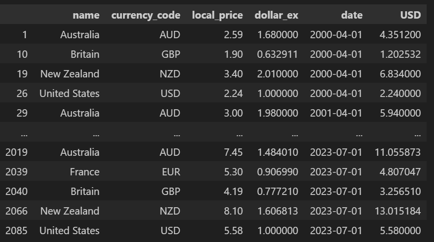

# Data Dictionary

A data dictionary is a centralised repository of information about data. It provides a detailed description of the data elements used in a system or database, including their meaning, relationships, format, and usage. In essence, it serves as a reference guide that helps users and developers understand the structure and content of the data.&#x20;

Each row in a data dictionary represents a field (or column) in a dataframe / database.

Here is an example based on the Big Mac dataframe.

**Data Frame in VS Code**

**Big Mac Data Dictionary**

| Field          | Datatype   | Format for Display | Description                                                                 | Example    | Validation                                                       |
| -------------- | ---------- | ------------------ | --------------------------------------------------------------------------- | ---------- | ---------------------------------------------------------------- |
| name           | str        | XX…XX              | Name of the country where the Big mac is available                          | Australia  | Can be any amount of characters but must not include numbers.    |
| currency\_code | str        | XXX                | Currency code which identifies the currency used in the country.            | AUD        | Must be 3 characters, all in capitals.                           |
| local\_price   | float64    | N.NN               | Local price of big mac in local currency.                                   | 2.59       | Must be a decimal number to 2 decimal places.                    |
| dollar\_ex     | float64    | N.NNNNNN           | Currency exchange from local currency to USD.                               | 1.680000   | Must be a decimal number to 6 decimal places or less.            |
| date           | datetime64 | YYYY-MM-DD         | Date the big mac was available at this price and the date of exchange rate. | 2000-04-01 | Must be in the format of YYYY-MM-DD, cannot be in reverse order. |
| USD            | float64    | N.NNNNNN           | Price of the Big Mac in any country in USD.                                 | 4.351200   | Must be the product of local\_price \* dollar\_ex.               |

**'str' Type**

Any string / raw character format is stored as a 'str' (string) in Pandas.

**Date Format in Pandas**

To get the datetime format, I added this code:

big\_mac\_df\['date'] = pd.to\_datetime(big\_mac\_df\['date'])

#### Your Data Dictionary

Look at the datasets you have found. For each .csv file / survey, consider the column headings you want in the data frames you create.

!!! warning "For Multiple Data Frames"

    For each separate data frame, you need a **separate** data dictionary (if you have more than one):

Here is what a blank table looks like if needed:

| Field       | Datatype    | Format for Display | Description | Example     | Validation  |
| ----------- | ----------- | ------------------ | ----------- | ----------- | ----------- |
| 
 
 | 
 
 | 
 
        | 
 
 | 
 
 | 
 
 |
| 
 
 | 
 
 | 
 
        | 
 
 | 
 
 | 
 
 |
| 
 
 | 
 
 | 
 
        | 
 
 | 
 
 | 
 
 |
