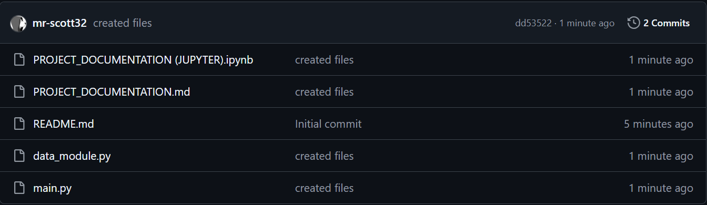

# Setting up Git Repository

Setup your GitHub repository, call it 9CT-Task-1, make it **public,** clone to your PC and create the following files in Visual Studio Code.

Then, commit and push so you are setup and ready to start your project.

!!! warning "Jupyter Notebook or Markdown?"

    Depending on what your teacher has shown you, you can keep your documentation in **Markdown** or **Jupyter Notebook.**

<figure><figcaption></figcaption></figure>

## Video Guide

If you cannot remember from class how to set this up, look at an example from a different task:

<iframe src="https://drive.google.com/file/d/1jFAir4TI9H2ZJGbYtV23SRkJuI3qpOoP/preview" allow="autoplay" allowfullscreen></iframe>

