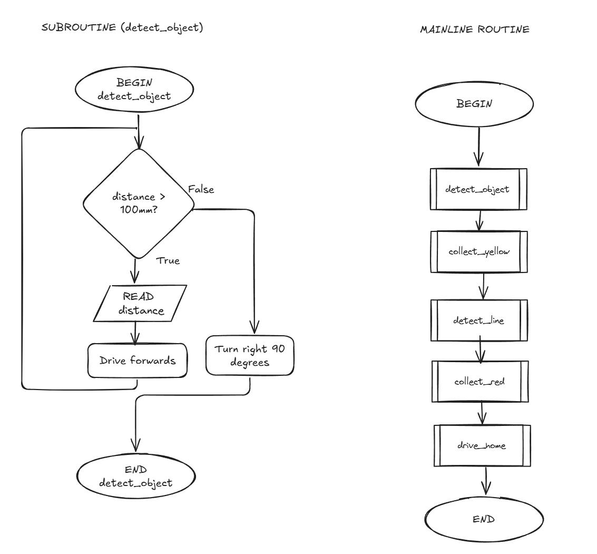

# Further Examples

## Example

Whilst not for Raspberry Pi PICO, this is an example of what flowcharts and pseudocode could look like for a mechatronic / robotic system.

### Flowchart for One Subroutine and Mainline Routine

<figure><figcaption></figcaption></figure>

### Pseudocode

```
BEGIN detect_object
    WHILE distance > 100mm
        READ distance
        Drive Forwards
    ENDWHILE
    Turn right 90 degrees
END detect_object


BEGIN
    detect_object
    collect_yellow
    detect_line
    collect_red
    drive_home
END
    
```
