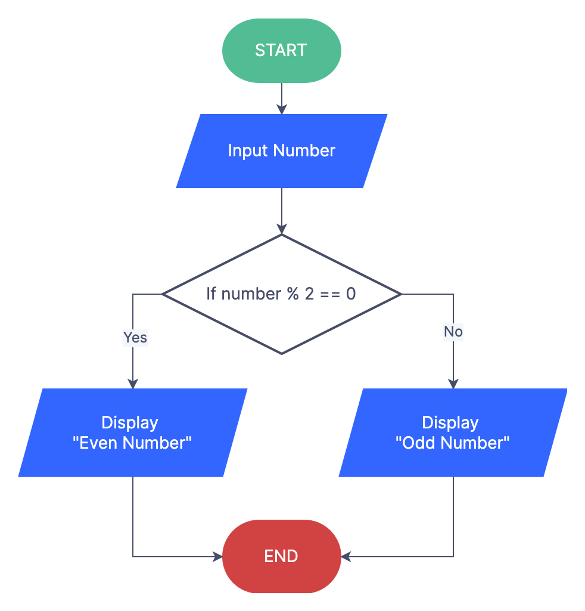
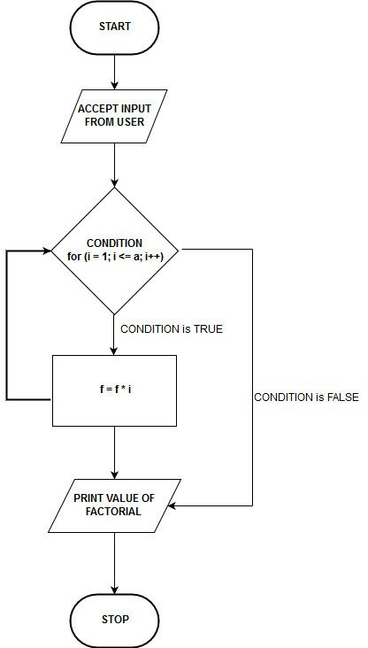

# Pseudocode Activities

!!! warning "Please Read:"

    These activities are not marked as part of your assessment, they are just to get you used to creating algorithms.

1. Write pseudocode to represent the following flowcharts:

a.&#x20;

<figure><figcaption></figcaption></figure>

b.

<figure><figcaption></figcaption></figure>

2. Write pseudocode to create the following systems:
   1. A customer is purchasing books from an online store. The system should:

      1. Allow the customer to enter the **price of each book**.
      2. Continue accepting book prices **until the customer types "done"**.
      3. **Calculate the total cost** of the books.
      4. **Apply a 10% discount** if the total is over **$100**.
      5. **Display the final amount** the customer needs to pay.

   2. A system needs to calculate the sum of numbers from 1 to a given number (N). The algorithm should:
      1. Prompt the user to enter a number, N.
      2. Use a **for loop** to add all the numbers from 1 to N.
      3. After the loop finishes, print the total sum.
