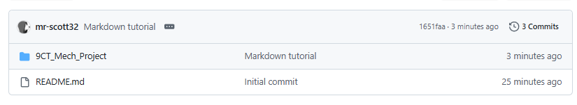
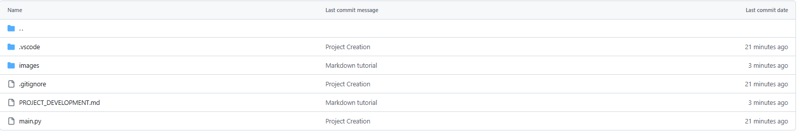

# Setting Up GitHub Repository

Setup your GitHub repository, call it yourname-9CT-Task-2, make it **public,** clone to your PC and create the following files in Visual Studio Code.

Then, commit and push so you are setup and ready to start your project.

!!! warning "Mechatronics Project"

    Remember that your Mechatronics Project actually has a folder with all its files in it that you will need to create.

<figure><figcaption>
Repo - Home
</figcaption></figure>

<figure><figcaption>
Repo - Inside 9CT_Mech_Project folder
</figcaption></figure>

## Video Tutorial

If you are not quite sure how to do the above, look at the following video for step-by-step instructions:

<iframe src="https://drive.google.com/file/d/1jFAir4TI9H2ZJGbYtV23SRkJuI3qpOoP/preview" allow="autoplay" allowfullscreen></iframe>

*Setup GitHub for Task 1*
