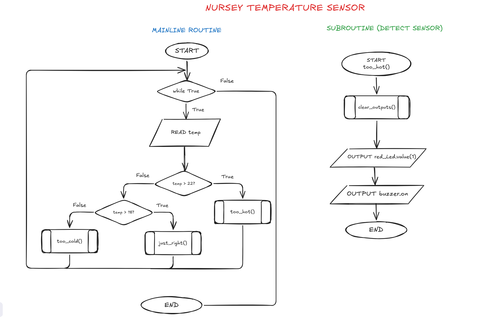

# Algorithms

!!! warning "**THREE ALGORITHMS**"

    You need to create **three algorithms** outlining your **proposed solution** using both **pseudocode and flowcharts.**&#x20;

    These algorithms **WILL BE MARKED.**&#x20;

    **For the purpose of THIS TASK, you may count EACH SUBROUTINE as a SEPARATE ALGORITHM (i.e. have one algorithm for your main routine (which uses the functions), then you can create subroutines for those functions used (define functions in Python).**


## Example

### Flowchart for One Subroutine and Mainline Routine

<figure><figcaption></figcaption></figure>

### Pseudocode

```
BEGIN too_hot()
    clear_outputs()
    OUTPUT red_Led.value(1)
    OUTPUT buzzer.on()
END too_hot


BEGIN
    WHILE true
        READ temp
        IF temp > 22 THEN
            too_hot()
        ELSE IF temp > 18 THEN
            just_right()
        ELSE 
            too_cold()
        ENDIF
    ENDWHILE
END  
```
