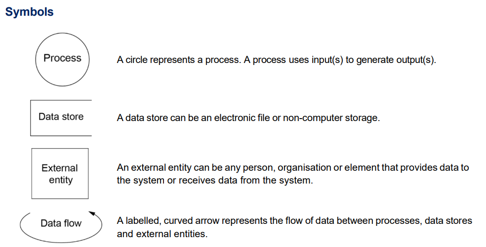
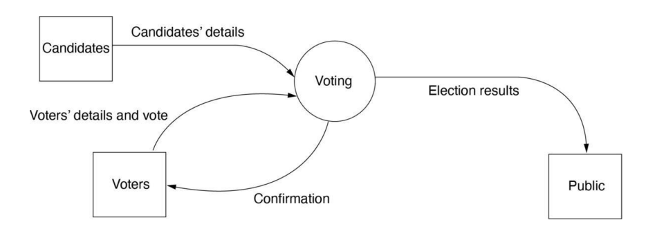
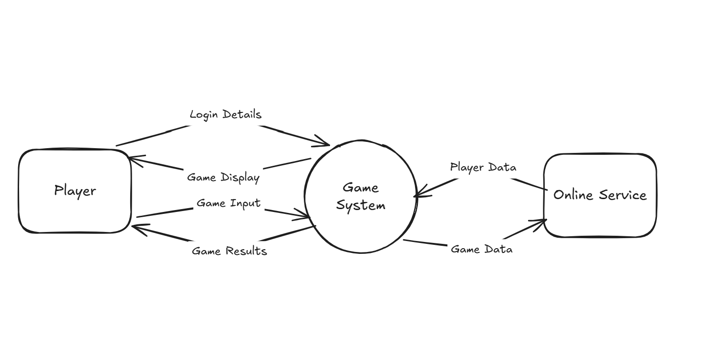

# Context Diagrams

!!! info "Learning Intention"

    Use program-development support tools, including Input Process Output (IPO) charts/diagrams, decision trees, flowcharts and structured English/pseudocode, in the development of a game or simulation

    Develop appropriate supporting documentation in a program to ensure it is easy to read, understand and maintain

    Create a record of project development demonstrating iterative design and evaluation

!!! success "Success Criteria"

    I can plan and represent the overarching flow of a system using a context diagram.

    I can identify and use the correct symbols to represent data flows, systems and external entities.&#x20;

A **context diagram**, also called a **Level 0 Data Flow Diagram (DFD)**, provides a high-level view of a system. It represents the **entire system as a single process** and shows how data moves between the system and the external entities that interact with it.

A context diagram does not show the individual processes or data stores within the system. Instead, it focuses on the **system boundary** and identifies what data enters and leaves the system.

For example, a game might have a **Player** as an external entity. The player could send data such as “Login Details” or “Game Input” to the game system, while the game system could send data such as “Game Display” or “Game Results” back to the player.

A context diagram therefore answers the question:

> **“What data enters and leaves the system, and who or what does it interact with?”**

### **How to Construct**

The following symbols are used to construct data flow diagrams, **however,** a context diagram **does not use any data stores.**

<figure><figcaption></figcaption></figure>

### **Voting System Example**

In the following system, candidates put their details into the voting system. Voters put in details and vote using the voting system, and receive a confirmation that they have voted. The voting system then generates election results to output to the public.

<figure><figcaption></figcaption></figure>

### **Video Game Example**

The following is a video game requiring a login and connects to an online service.

The player could send data such as “Login Details” or “Game Input” to the game system, while the game system could send data such as “Game Display” or “Game Results” back to the player.&#x20;

An online service may send palyer data to the game system, and the game system will share game data with the online service.

<figure><figcaption></figcaption></figure>

A context diagram is useful as the starting point for developing a more detailed DFD. The **Level 1 DFD** expands the single process from the context diagram into the major processes within the system and can also show data stores. The external entities and major data flows shown in the context diagram should remain consistent when the system is expanded into the Level 1 DFD.
