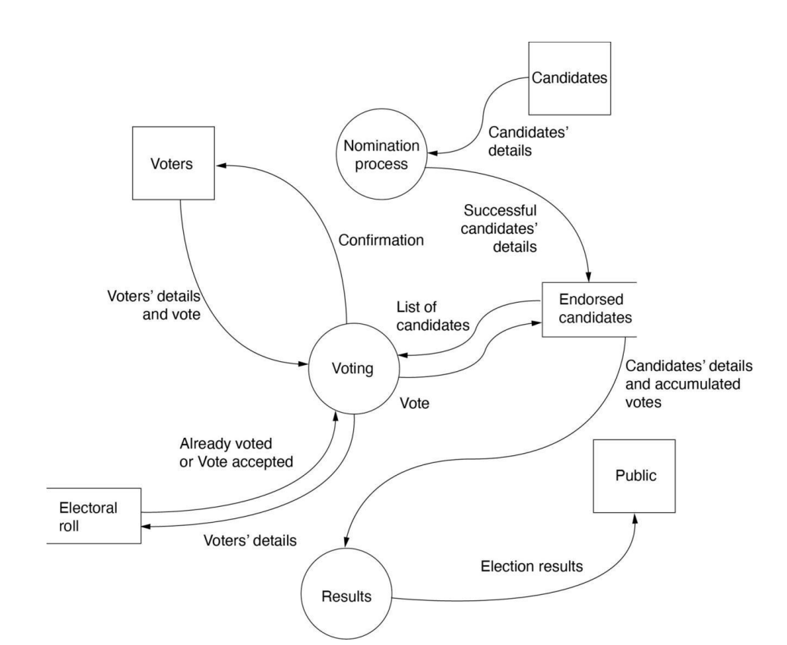
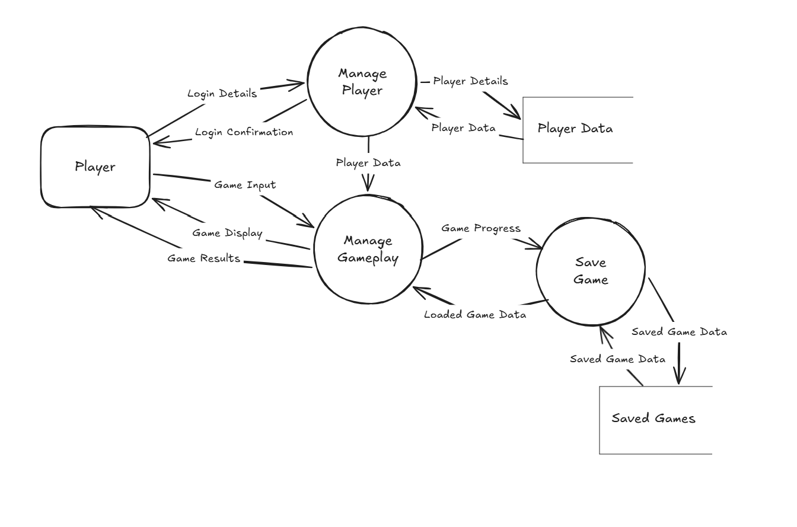

# Data Flow Diagrams

!!! info "Learning Intention"

    Use program-development support tools, including Input Process Output (IPO) charts/diagrams, decision trees, flowcharts and structured English/pseudocode, in the development of a game or simulation

    Develop appropriate supporting documentation in a program to ensure it is easy to read, understand and maintain

    Create a record of project development demonstrating iterative design and evaluation

!!! success "Success Criteria"

    I can plan and represent a range of processes and data flows using a data flow diagram (Level 1).

    I can identify and use the correct symbols to represent data flows, data stores, processes and external entities.&#x20;

A Data Flow Diagram (DFD) is a way of representing how data moves through a system. In a game, a DFD can be used to show where information comes from, what the game does with that information, where information is stored, and where information is sent.

A DFD is concerned with the movement and handling of data rather than the order in which instructions are carried out. For example, a game might receive information about a player's selected character, use that information to load the character's attributes, and then send the resulting character information to the gameplay system.

A Level 1 DFD provides more detail about the major processes within a system.

## Main components

The four main components you need to recognise are external entities, processes, data stores and data flows.

### External entities

An external entity is something outside the system that provides data to the system or receives data from it.

In a game, a player, an online service or a game administrator could be an external entity. The entity is considered external because it interacts with the software but is not itself part of the software being represented.

### Processes

A process represents something the system does with data. It receives information, uses or changes that information, and produces a result.

Processes should normally describe an action, such as:

* “Validate Player Profile”
* “Calculate Race Result”
* “Update Mission”

A process is different from a piece of data. “Player Profile” describes information, whereas “Load Player Profile” describes an operation performed by the system.

### Data stores

A data store represents information that the system keeps so that it can be used later.

A game might store:

* Player profiles
* Saved progress
* Unlocked achievements
* Tournament results

The important idea is that a data store represents persistent information rather than an action being performed by the program. Data can be sent to a data store when information is saved and retrieved from it when information is needed.

### Data flows

A data flow represents data moving between components of the system.

The direction of the flow is important because it indicates where the data is coming from and where it is going. For example, a player might provide “Character Selection” to a process that loads the chosen character. The arrow represents the movement of that information, not simply the fact that two components are related.

### Voting System Example

<figure><figcaption></figcaption></figure>

### Video Game Example

The following is a video game requiring a login and allows the player to save their game progress.

The player sends **Login Details** to the **Manage Player** process, which accesses **Player Data** stored in the **Player Data** data store. The player also sends **Game Input** to the **Manage Gameplay** process, which uses the player data to produce **Game Display** and **Game Results** for the player.

When the player makes progress, **Game Progress** is sent to **Save** **Game**, which stores the information in the **Saved Games** data store. Saved game data can also be retrieved and sent back to **Manage Gameplay** when the player loads a saved game.

<figure><figcaption></figcaption></figure>

## Interpreting a DFD

When interpreting a DFD, you should carefully consider what each element represents and whether the direction of each data flow makes sense.

!!! warning "Common Mistake"

    A common mistake is to treat an action as though it were data. “Open Inventory” is an action, while “Inventory Request” or “Inventory Data” describes information that could appropriately be represented as a data flow.

You should also be able to distinguish between a process that handles information and a data store that retains information.

## Why DFDs are useful

DFDs are useful because they allow a developer to understand how information moves through a system before considering the detailed code.

They can reveal:

* Missing data flows
* Incorrect directions
* Unnecessary processes
* Places where information needs to be stored

A DFD therefore provides a model of the information requirements of a game rather than a model of the game's user interface or program structure.
