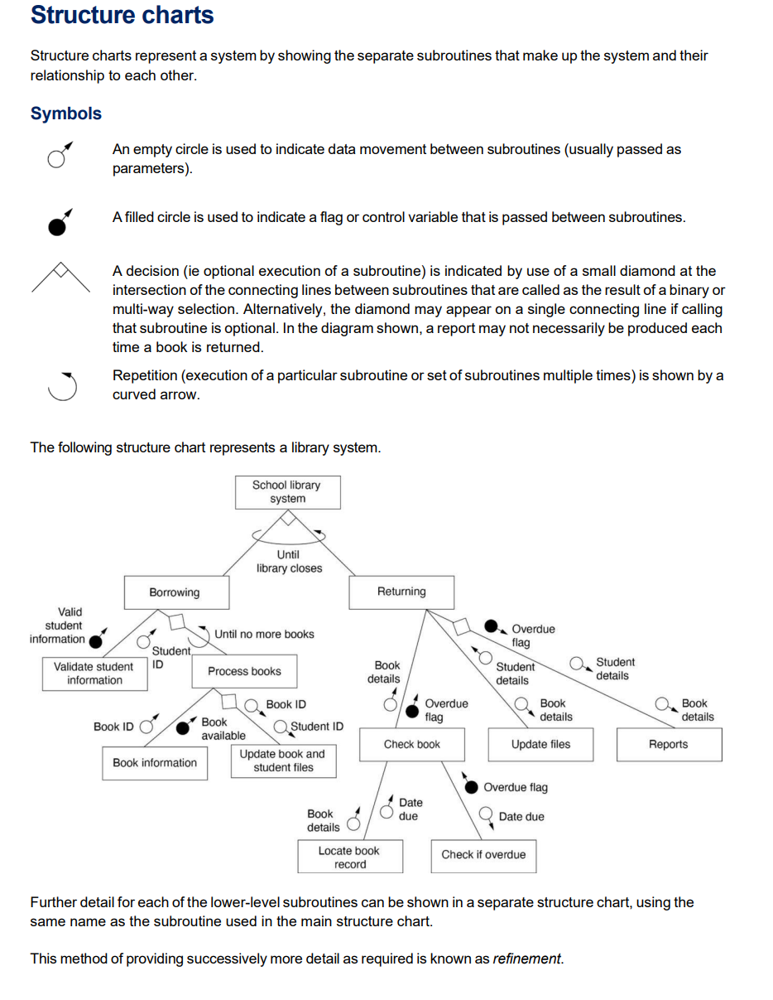
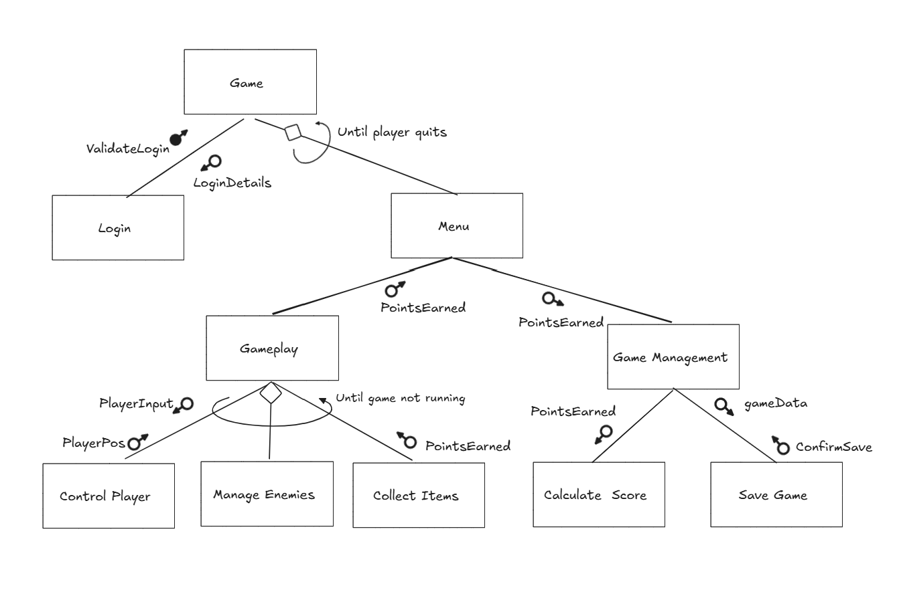

# Structure Charts

!!! info "Learning Intention"

    Use program-development support tools, including Input Process Output (IPO) charts/diagrams, decision trees, flowcharts and structured English/pseudocode, in the development of a game or simulation

    Create and modify algorithms and code that use branching and iteration, and represent them diagrammatically and in English

    Develop appropriate supporting documentation in a program to ensure it is easy to read, understand and maintain

    Create a record of project development demonstrating iterative design and evaluation

!!! success "Success Criteria"

    I can plan and represent system modules / functions using a structure chart.

    I can identify and use the correct symbols to represent modules, parameters, control variables, decisions and repetition.

A structure chart is a representation of the way a system is divided into modules. It provides a hierarchical view of a program by showing major functions at higher levels and the smaller components that make up those functions underneath them. Structure charts are particularly useful when a game contains many different systems that would be difficult to manage as one large program.

A module is a self-contained section of a program that has a particular responsibility. In a game, separate modules might manage player movement, missions, sound, inventory, scoring or menus. Dividing a program into modules is known as modular design. Instead of trying to design and develop the entire game as one piece, developers can work on smaller sections with clearly defined purposes.

A good structure chart begins with the overall system and then breaks it down into major functions. For example, a game might have a main Game module that contains a Menu System, Gameplay System and Save System. The Gameplay System could then be divided into Player Management, Environment Management and Mission Management. The chart therefore shows the relationship between the larger system and its smaller components.

The names used in a structure chart should communicate what each module is responsible for. Names such as "Manage Inventory", "Process Player Input" or "Calculate Results" are more useful than vague names such as "Game Stuff" or "Code". Clear names help developers understand the purpose of each part of the system without needing to inspect the program code.

## Advantages of Modular Design

* Smaller modules are easier to understand, develop and test.
* If a problem occurs in one part of the game, developers can investigate the relevant module rather than searching through the entire program.
* Modules can make it easier for different developers to work on different parts of a project.

### Library Example

<figure><figcaption></figcaption></figure>

### Game Design Example

The following system requires user to validate login details before accessing game menu. Gameplay runs until the game is not running, points earned make their way to game management once players quit back to main menu, which are used to calculate total ongoing score.

<figure><figcaption></figcaption></figure>

## Structure Charts and DFDs

A structure chart should not be confused with a DFD. A structure chart describes how the program is organised into functional modules, whereas a DFD describes how data moves through a system.

For example, a structure chart might show that a game contains a Player Management module and an Inventory Management module. A DFD could instead show that an Item Pickup process receives an item selection and produces updated inventory data. The two diagrams describe the system from different perspectives.
